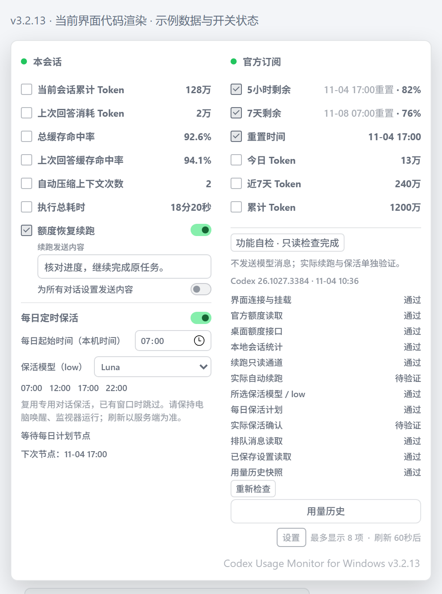
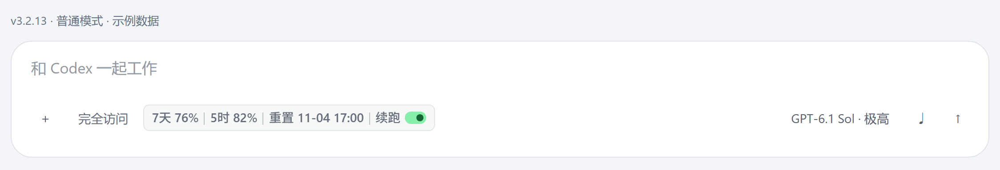
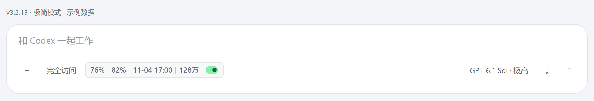
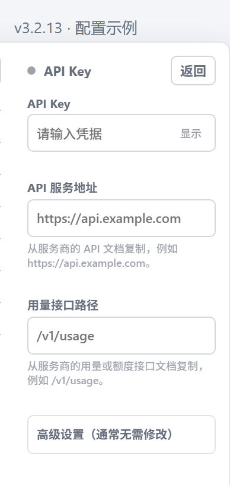

# Codex Usage Monitor for Windows

> In-app usage monitor and status bar for OpenAI Codex Desktop on Windows

[](https://github.com/leeanvien/Codex-Desktop-Usage-Monitor-Windows/actions/workflows/ci.yml)
[](https://github.com/leeanvien/Codex-Desktop-Usage-Monitor-Windows/releases/latest)

本仓库是 [@leeanvien](https://github.com/leeanvien) 基于 [上游项目](https://github.com/JiaYang-BUAA/Codex-Desktop-Usage-Monitor-Windows) 维护的社区增强版，新增 **每日定时保活**、**功能自检** 和相关兼容性修复；保留原 MIT 许可证与来源声明。

Codex Usage Monitor 把官方订阅周期、当前会话 Token、社区重置概率、Tibo 最新 X 动态，以及可选的 API 账户和 API Key 用量，直接放到 Windows 版 Codex Desktop 的输入区域旁。

监视器通过仅绑定本机的 Chrome DevTools Protocol（CDP）运行时注入，不是独立悬浮窗，也不修改 WindowsApps、`app.asar`、Codex 登录文件或模型配置。

> 本项目是非官方项目，与 OpenAI 没有隶属、赞助或背书关系。社区重置概率和 Tibo 动态也不是 OpenAI 官方数据。Codex 更新可能改变页面结构；项目会持续通过兼容性测试适配新版界面。



配图由当前 **v3.2.13 界面代码**独立渲染，均为示例数据。上图已开启定时保活、展开功能自检并完整展示滚动区域，预测/API 栏已隐藏；开关状态并非默认设置，实际执行项仍显示“待验证”。

主要功能：

- 在一个面板中查看“本会话”“官方订阅”“重置概率预测（仅供参考）”，并按需开启 API 账户和 API Key 两栏。
- 查看当前会话累计 Token、上次回答消耗 Token、总缓存命中率、上次回答缓存命中率、自动压缩上下文次数和执行总耗时。
- 查看 5 小时与 7 天官方周期、重置时间、今日 Token、近7天 Token和累计 Token。
- 每 5 分钟显示社区重置概率和 Tibo（[`@thsottiaux`](https://x.com/thsottiaux)）最新 X 动态摘要。
- 支持普通模式、极简模式、倒计时可视化、中文与 English UI、自动更新和按任务独立的额度恢复续跑。
- 每日定时保活可选模型与 low 思考强度，复用专用对话；已有窗口时跳过，实际额度刷新以服务端为准。
- 功能自检在 Codex 更新后核对本机读取、续跑通道与保活依赖；实际执行结果单独验证。
- 设置中的“30 秒刷新”开关可将官方订阅和 API 用量轮询从 60 秒改为 30 秒，关闭后恢复 60 秒；即时生效并保存。本地 Token 扫描与重置预测缓存频率不变。
- 使用当前 Windows 用户的 DPAPI 加密保存 API 凭据，不把凭据写入源码、页面设置或日志。

## 1. 三步开始使用

当前本地定制版本 **v3.2.13**：修复闲置时本地统计仍在扫描却被误判过期的问题；读取最新扫描快照并区分未选对话和真正读取故障，保留 Codex 26.1027 适配、定时保活和更新保护。变更见 [更新日志](CHANGELOG.md)。

### 1.1 准备环境

- Windows 10 或 Windows 11。
- 已安装并能正常登录的 Codex Desktop。
- Node.js 22 或更高版本。
- 推荐使用 PowerShell 7，并确认命令 `pwsh` 可用。
- 安全软件：项目使用隐藏 PowerShell、Node.js 后台进程和 CDP 参数，可能触发启发式误报。确认安装包来自本仓库后，为项目目录、启动脚本或相关进程添加精确信任规则，或者直接关闭杀毒软件。

### 1.2 下载、安装、启动

1. 从 [最新 Release](https://github.com/leeanvien/Codex-Desktop-Usage-Monitor-Windows/releases/latest) 下载 `codex-usage-monitor-windows-*.zip`。
2. 解压 ZIP，在解压目录中运行：

   ```powershell
   pwsh -NoProfile -File .\install.ps1
   ```

3. 正常退出已经打开的 Codex，然后双击桌面的 `Codex Usage Monitor` 快捷方式。

专用快捷方式会同时启动 Codex 和监视器，并隐藏正常的黑色命令行窗口。Codex 尚在加载组织设置或主界面时，等待助手会持续等待并在界面就绪后自动连接；关闭对应 Codex 后，等待助手也会退出。重复点击会复用已有启动过程。原生 Codex 图标不会开放本机 CDP 端口，因此从原生图标启动时不会显示监视栏。

### 1.3 让 Codex 帮你安装

不熟悉 PowerShell 时，可以把下面这段话直接发送给 Windows 版 Codex：

```text
请安装这个项目：https://github.com/leeanvien/Codex-Desktop-Usage-Monitor-Windows
先阅读仓库根目录的 AGENTS.md 和 README.md，再运行 install.ps1。自动寻找 Microsoft Store 和常见非 Store Codex 路径；找不到时才询问我选择真实的 ChatGPT.exe 或 codex.exe。不要猜路径，不要修改 WindowsApps、app.asar、Codex 登录文件或模型配置，也不要强制终止或重启我当前的 Codex。安装后验证桌面的“Codex Usage Monitor”快捷方式。
官方订阅无需配置。API 账户和 API Key 请优先指导我在监视栏展开面板中填写；密钥不能粘贴到聊天、源码、JSON 或日志。找不到服务商字段时，请根据公开文档或脱敏截图解释，不要猜测接口。
```

## 2. 日常使用

### 2.1 折叠监视栏

监视栏位于 Codex 输入区域底部。新安装默认勾选“7天剩余”和“当前会话累计 Token”，普通模式最多显示 8 项。

ChatGPT 普通聊天模式不挂载监视栏；ChatGPT Work 工作模式和 Codex 任务继续显示。切回工作模式或 Codex 任务后自动恢复，原有显示设置不变。

指标会严格按照勾选顺序从左到右排列；取消后重新勾选的项目会移动到末尾。展开面板中的“5小时剩余”和“7天剩余”显示为“重置时间 · 剩余百分数”，折叠栏只保留百分数。

识别为 Pro 账户时，保留“5小时剩余”及勾选框，数值显示为 `--`，折叠栏也不显示百分数；“重置时间”使用主额度的 7 天窗口。Spark 等模型独立额度不会混入官方订阅展示；其他套餐保留原有 5 小时显示。



### 2.2 极简模式

极简模式隐藏指标名称，只保留数值、单位和必要开关，最多选择 14 项；选中 9 项及以上时自动使用双行布局。



### 2.3 展开面板

点击监视栏即可展开面板。新安装默认显示三栏：

| 栏位 | 默认状态 | 主要内容 |
| --- | --- | --- |
| 本会话 | 显示 | 当前会话累计 Token、上次回答消耗 Token、总缓存命中率、上次回答缓存命中率、自动压缩上下文次数、执行总耗时和额度恢复续跑。耗时累计各轮执行时间，不计轮次之间的等待；`≈` 表示含估算，`+` 表示记录不完整。 |
| 官方订阅 | 显示 | 5 小时/7 天周期、重置时间、今日/近7天/累计 Token 和全局设置。 |
| 重置概率预测（仅供参考） | 显示 | 12/24/48/72 小时社区概率、重置预告方式，以及 Tibo 最新 X 动态缩略卡片。 |
| API 账户 | 隐藏 | 第三方用户账户余额、请求日志和累计 Token。 |
| API Key | 隐藏 | 某个 API Key 的额度、限额、到期时间和请求状态。 |

每栏使用独立固定宽度，不会因为其他栏显示或隐藏而被压窄。面板会根据已启用栏位向左扩展，并优先保证右边缘和每栏内容完整显示。

“上次回答消耗 Token”只在回答完成后更新。回答生成期间，它会继续显示最近一次已完成回答的数据，不会混入当前尚未完成的内容。

#### 用量历史

在“官方订阅”栏点击“用量历史”，可查看 Token 柱状图和额度剩余曲线，并切换“今日 / 7 天 / 30 天”。图表按本机时区显示；今日按小时汇总，7 天与 30 天按自然日汇总。点击“返回”恢复原面板，不增加常驻监视栏的长度。

Token 图复用本机增量扫描，只统计已采集且能确认使用官方订阅的任务记录，不等同于跨设备账户总用量，也不保证首次启用就具有完整 30 天历史。额度曲线来自启用此功能之后实际收到的官方额度快照；缺失或未采集的时间不回填，不根据 Token 推算额度，也不把未知值当作 0%。

### 2.4 设置与保存

点击“官方订阅”栏底部的“设置”，可以调整：

| 设置 | 作用 |
| --- | --- |
| 极简模式 | 只显示数值、单位和必要开关。 |
| 倒计时可视化 | 使用圆形表盘显示刷新进度。 |
| English UI | 切换中英文界面。 |
| 自动更新 | 每 24 小时检查一次最新正式 Release。 |
| API 栏 | 同时显示或隐藏 API 账户与 API Key。新安装默认关闭。 |
| 重置概率预测栏 | 显示或隐藏社区概率与 Tibo 动态。新安装默认开启。 |

显示项、勾选顺序和上述全局设置保存在：

```text
%USERPROFILE%\.codex-usage-monitor\ui-settings.json
```

显示项目、排列顺序、界面开关、每日保活及每个对话的续跑设置都即时保存到这个固定文件。它位于 Store AppData 虚拟化范围之外，桌面快捷方式与 Codex 内启动都使用同一份配置；浏览器缓存不可用时仍会提交后端保存。首次缺少新文件时会读取并迁移旧 `%LOCALAPPDATA%\CodexUsageMonitor\ui-settings.json`，不删除旧文件；已有有效新文件优先，不再反复导入旧设置。可通过 `CODEX_USAGE_UI_SETTINGS_PATH` 显式指定其他路径。

新安装才使用默认布局。损坏的新设置文件会保留并报错，不会静默用默认值覆盖。登录文件、API 凭据、额度统计及发送状态目录不迁移。

若旧版自动更新一直停留在 `installing`，请先手动下载安装 v3.1.7 或更新版本；本次修复安装后，继续开启“自动更新”即可使用新的后台安装方式。

### 功能自检

展开监视栏，在“官方订阅”底部点击 **功能自检**，可查看各项检查结果并点击 **重新检查**。启动时自动检查；检测到正在运行的 Codex 版本或页面构建变化时重新检查。正常每 10 分钟复查，失败或读取超时后每分钟重试；手动检查间隔至少 30 秒。有异常时监视栏出现 `!` 提示，点击可直达结果。

“桌面额度接口”与“续跑只读通道”分开取证。后者检查内部客户端及当前对话读取；额度接口暂时超时不再被当成发送通道损坏。请求使用后台优先级、10 秒单次超时，独立只读请求并行，必要时尝试其他已连接的本机请求页面；有限页面均未确认时保留真实结果。读取超时显示“等待重试”，明确的客户端缺失、无效响应或对话无法读取仍提示异常。未选择当前对话时该项待验证。

脱敏状态文件还保存最近一次各步骤的布尔结果和 `timeout`、`unavailable`、`invalid-response` 固定分类，不保存原始错误消息、对话 ID 或请求正文。

Codex 26.1027 的连接从已有作用域中读取已绑定且就绪的本机 RPC 客户端；不导入应用模块或创建任务管理连接。新版队列通过对话的只读订阅检查，最多等待 5 秒并释放订阅，不修改队列；未选择对话时待验证。旧版队列查询仍兼容。本地会话统计采用本机扫描时间，不因官方网络数据过期而连带报错。

本机扫描没有发现数值变化时，仍保留减少界面通知的优化；自检从扫描器最新快照读取独立的扫描时间，不把“上次数值变化”当成“上次扫描”。官方累计值更新不能刷新该扫描时间。首次扫描或未选择当前对话时待验证；本地记录不可读、扫描真正超过 15 分钟未更新仍提示异常。扫描频率不变，不增加额外文件扫描。

检查界面连接、官方额度、会话数据、内部请求与当前会话读取、所选模型/low、保活计划、排队消息、已保存设置、历史快照，以及已配置的 API 数据、重置预告和已有更新记录。未启用项目显示“未启用”。只复用现有 API 数据状态，不额外请求服务商或触发更新。

自检不发送模型消息、不新建/恢复对话、不改写排队消息。“续跑只读通道通过”表示依赖可读，不能证明 `turn/start` 必然成功；**实际自动续跑**仅在正常续跑被接受后标为通过，**实际保活确认**仅在正常保活完成并确认窗口后标为通过。没有当前构建的实际记录显示“待验证”；版本变化不会沿用上一构建的成功记录。自检不能模拟未来计划触发或保证 Codex 后续内部变化自动修复。

构建标识和无正文的实际执行结果保存在 `%USERPROFILE%\.codex-usage-monitor\compatibility-state.json`。Store 版本来自真正运行且开放所选 CDP 端口的程序路径，不把尚未生效的商店更新或 Chromium 文件版本当成 Codex 版本；非 Store 版本未知时仍以页面资源标识检测变化。自检失败不会停用原有续跑或保活，原功能继续按其安全条件工作。

### 2.5 额度恢复续跑

“额度恢复续跑”默认关闭，启停按 Codex 任务分别保存。发送内容默认各自独立，也可开启“为所有对话设置发送内容”统一设置。

输入框下方的“为所有对话设置发送内容”控制内容的适用范围：

| 操作 | 发送内容如何变化 |
| --- | --- |
| 默认关闭 | 每个对话独立设置，初始内容为“继续”。 |
| 开启统一设置 | 所有对话使用同一份内容，修改输入框即更新统一内容。 |
| 关闭统一设置 | 各对话保留关闭时的统一内容，不恢复旧内容；之后可各自修改。 |

尚未单独配置的对话以最近一次统一内容为初始值。这个开关只统一发送内容，不会开启其他对话的自动续跑。

开启后，监视器只会在以下条件全部成立时发送续跑内容：

1. 当前任务明确以 `usage_limit_exceeded` 结束。
2. 该对话仍明确处于额度用尽暂停状态，没有开始新回合、执行完成或主动暂停。
3. 耗尽事件之后更新的官方订阅数据确认阻塞周期已有剩余额度；提前恢复额度也可触发。

可以在额度耗尽后开启续跑。已开启的对话分别记录等待状态，切换到其他对话后仍会跟踪；重启监视器后会重新核对记录。暂时缺少会话数据时保留等待，等待数据确认后再发送。

若发送通道不可用或请求超时，展开面板会显示原因并等待重试。监视器必须保持运行，且 Codex 桌面的发送通道可用。

默认发送内容为“继续”，可修改为最多 500 字符的单行文本。监视器在 Codex Desktop 内部按原任务 ID 调用 `thread/resume` 和 `turn/start`，不会填写或占用可见输入框，也不会删除或覆盖原有排队消息。每个额度事件使用稳定的客户端消息 ID，并在当前渲染器内复用进行中或已成功的请求，减少重复提交；发送回合仍会正常消耗 Codex 额度。

等待记录保存在 `%LOCALAPPDATA%\CodexUsageMonitor\auto-resume-state.json`，不包含发送内容、对话正文或凭据。

### 2.6 每日定时保活（本地定制功能）

通过桌面 **Codex Usage Monitor** 专用快捷方式启动，点击输入框旁的监视栏展开面板。在“本会话”栏的续跑设置下面，打开 **每日定时保活**，填写“每日开始时间”，在 **保活模型（low）** 下拉框选择模型。列表从当前官方账户实际读取，仅显示支持 low 的可见模型，约每 5 分钟刷新。默认保留 `gpt-6-luna`；不可用时提示，不擅自换模型。设置即时保存，默认关闭；它是全局计划，切换对话不会改变。

例如 Windows 本地时区为北京时间，设置 `07:00`，每天四个节点为 **07:00、12:00、17:00、22:00**；跨午夜的节点会标注“次日”。修改时间会更新预览，不会补发已经错过的节点。每个节点最多等候 10 分钟（包括桌面短暂断线、已有窗口即将到期），超时等下个节点。

保活使用独立的空目录和同一个专用对话：当前账户首次保活时创建并保存对话标识，之后每个节点继续使用它，重启监视器仍复用。请求所选模型的 `low` 强度，内容固定为“只回复 OK。”；更换模型也沿用这个对话。不会在当前开发任务中发送，也不使用或改动输入框、排队消息、原任务模型。模型或 low 不可用时跳过，不自动换成其他模型。

升级前已有本工具成功提交的保活对话时，优先固定并复用其中最近一个。不同账户分别绑定，不能跨账户复用。请将这个对话保留为保活专用；如果删除、归档、用于其他任务或无法确认其为空闲状态，程序会暂停，不会不断新建替代对话。创建结果不明确时也保留防重复屏障，避免重启后再创建。

- 每个节点都只读核对当前官方订阅账户、实时 5 小时和 7 天额度。未知、过期、耗尽、没有 5 小时窗口、账户 ID 不可核对，或接口未明确允许普通额度使用时，不发送。API Key 模式不支持此功能。
- 已有实际使用或结束时间固定的 5 小时窗口时跳过。接口可能在未启动窗口时返回不断后移的“查询时间＋5 小时”，程序不会仅凭未来时间或剩余 100% 判定；会比较同账户至少相隔 60 秒的实时样本。首次核对可能稍后于计划时间发送，证据不足继续等待。
- 每个节点保留 10 分钟宽限。例如计划 15:30、旧窗口实际 15:31 到期，会在到期后继续核对并尝试保活；若接口返回滚动估计，则先观察约 1 分钟。15:40 后仍未满足条件才放弃该节点，等待下个节点；不提前重置已有窗口。
- “已提交”仅表示桌面接受发送；只有同一保活回合完成并回复 OK，且同账户实时数据表明有实际使用或固定的新 5 小时窗口，才显示“已确认”。持续滚动的重置估计不会被当成成功。实际起算和刷新以服务端为准，多次采样属于本工具的观测判断，并非官方活动窗口标志。
- 发送前写入并同步保存意图。超时、断线或崩溃造成结果不明确时，不自动重发；同一节点的记录跨重启保留。不要删除状态文件来尝试重发。
- 发送前额度条件若变化，且能明确确认尚未尝试创建对话或提交回合，原后台可在本节点宽限内重新预检。未知结果不重试；重启或其他后台不会继承这一临时重试权限。
- 电脑需保持开机、不休眠，并持续运行从专用快捷方式启动的 Codex 和监视器。程序不会自动修改系统电源策略。
- 原有“额度恢复续跑”开关仍按任务单独开启，恢复后仍按其原规则继续任务，不会因保活计划而延后。避免同时在 Codex Keeper 中开启另一套定时保活或同任务续跑。

状态文件：`%LOCALAPPDATA%\CodexUsageMonitor\daily-keep-alive-state.json`，旁边的同名 `.claims` 目录保存跨进程、跨重启防重复的独占节点记录，`.threads` 目录永久保存各账户专用对话绑定及创建防重复记录。对话绑定先同步写盘，之后才发送模型消息。仅保存节点、账户 ID、发送状态及回合标识，不保存登录凭据或对话正文。设置仍保存在原 `ui-settings.json` 中。

#### 定制版与自动更新

上游自动更新安装完整发行包，不会合并本地代码修改；直接更新到不含保活功能的上游版会丢失这些定制功能，且上游设置保存也可能丢弃其不认识的字段。

本地版仍保留自动更新开关、24 小时检查、正式版本与 GitHub SHA-256 校验。另增加包兼容检查：候选版本必须声明 `daily-keep-alive-model-selection-v1` 能力并包含相应安装文件，否则在执行安装器之前拒绝更新，继续运行现有监视器，不更改保活设置、对话绑定或 Codex。

因此，不带该兼容标记的普通上游包不会自动安装；要获取其更新，需要先将定制功能合入新版。兼容包沿原路径安装并热替换监视器后台，复用状态目录；短暂重载依靠既有节点宽限和防重复记录处理，并不保证后台完全没有停顿。手动安装普通上游版仍可能覆盖定制功能。

## 3. 数据源与配置

### 3.1 数据源总览

| 数据源 | 数据内容 | 需要准备 |
| --- | --- | --- |
| 官方订阅 | 5 小时/7 天周期、重置时间、今日/近7天/累计 Token。 | 无需额外凭据。 |
| 重置概率预测（仅供参考） | Codex Reset Observatory 的社区概率和 Tibo 最新 X 动态。 | 无需凭据；可在设置中隐藏。 |
| API 账户 | 第三方账户余额、累计已用额度、请求日志和 Token 账本。 | Base URL、数字用户 ID、账户访问令牌、累计 Token 基准。 |
| API Key | 单个 Key 的已用额度、限额、到期时间和请求状态。 | API Key；首次配置还需服务地址和用量接口路径。 |

更完整的指标口径、Token 累计逻辑、状态灯和 Provider 字段映射见 [数据源与指标说明](docs/data-sources.md)。

### 3.2 官方订阅

官方订阅通过 Codex Desktop 本机 app-server 读取，无需填写任何凭据。红色指示灯表示本轮请求失败但仍保留上一次成功数据，不代表额度耗尽或模型不可用。

### 3.3 重置概率与 Tibo 动态

重置概率来自 MIT License 开源项目 [Codex Reset Observatory](https://github.com/gussuri/codex-reset-observatory)。本项目只读取并显示它汇总的 12/24/48/72 小时社区概率，不训练预测模型，也不使用预测结果触发自动续跑。

概率下方的“预告方式”根据上游当前有效预告显示“发放重置卡”（需手动使用）或“直接重置”（恢复额度）；没有明确预告时显示“暂未明确”。这一说明仅在展开面板显示，不占监视栏勾选名额，也不代表当前账户已收到重置。

监视器每 5 分钟向以下固定 HTTPS 接口发送一次无凭据 GET 请求：

```text
https://codex.gussuriworks.com/api/current?locale=zh
```

请求不包含 Codex 登录信息、任务 ID、对话内容、Token 统计、API Key 或账户令牌。上游返回 `stale=true` 时，该栏显示红灯并保留最近数据。

同一响应中的 `latestTiboActivity` 用于缩略展示 Tibo 在 X 上的最新公开动态。监视器不会登录或单独抓取 X；动态和概率同步每 5 分钟更新，只显示三行正文摘要、发布时间，以及限定为 `x.com/thsottiaux/status/...` 的原帖链接。该字段由第三方项目整理，仍属于非官方信息。

### 3.4 API 账户

开启“API 栏”，点击“API 账户”标题后的“配置”，填写：

- API 服务 Base URL。
- 数字用户 ID。
- 账户访问令牌（Access Token）。
- 当前真实的累计 Token 基准；不知道精确值时填 `0`。

保存前会验证账户接口并读取当前日志建立检查点，成功后使用 DPAPI 加密保存访问令牌。账户访问令牌不一定等于 API Key。

### 3.5 API Key

开启“API 栏”，点击“API Key”标题后的“配置”：

- 已有连接配置时，通常只需填写或更换 API Key。
- 首次配置时，填写 API Key、API 服务地址和用量接口路径。
- 认证头和响应字段映射位于“高级设置（通常无需修改）”。
- 密钥框不会回填；已经配置时留空可保留原密钥。



如果服务商返回 `HTTP 429`，界面会显示“请求受限”，并保留旧数据。这不一定表示 Key 失效；监视器会按 60、120、240、300 秒逐步退避，成功后恢复为 60 秒刷新。

## 4. 更新、安装与维护

### 4.1 自动更新

自动更新开启后，运行中的监视器最多每 24 小时检查一次 `leeanvien/Codex-Desktop-Usage-Monitor-Windows` 的 GitHub Release。不会从原作者的仓库覆盖这个修改版。发现正式新版本时，它会：

1. 下载名称和版本严格匹配的 Windows ZIP。
2. 核对 GitHub 提供的 SHA-256 摘要。
3. 校验通过后安装并热替换监视器后台。

更新不会重启 Codex。检查、下载或校验失败时继续使用当前版本，并在下个周期重试。

**更新后如果“功能自检”存在异常，请自行让 AI（例如 Codex）协助排查和修复。** 将自检异常项及当前 Codex 版本附在下面这段话后发送给 AI：

```text
请检查并修复 Codex Usage Monitor 的功能自检异常。
先阅读项目根目录的 AGENTS.md 和 README.md，根据自检结果和当前 Codex 版本定位原因。
保留现有定时保活、额度恢复续跑和用户设置，修复后完成必要测试。
```

### 4.2 安装位置与运行包

安装器把白名单运行文件复制到：

```text
%LOCALAPPDATA%\Programs\CodexUsageMonitor\<版本号>
```

运行包不包含 Node.js、Codex、API Key、用户日志或本地 Provider 配置。桌面快捷方式会始终指向对应版本的启动脚本。

### 4.3 从源码安装

```powershell
git clone https://github.com/leeanvien/Codex-Desktop-Usage-Monitor-Windows.git
cd Codex-Desktop-Usage-Monitor-Windows
pwsh -NoProfile -File .\install.ps1
```

安装器会优先寻找 Microsoft Store 和常见非 Store 路径；找不到时才询问实际文件。也可以提前设置真实路径：

```powershell
[Environment]::SetEnvironmentVariable('CODEX_USAGE_DESKTOP_PATH', 'D:\Apps\Codex\ChatGPT.exe', 'User')
[Environment]::SetEnvironmentVariable('CODEX_USAGE_CODEX_PATH', 'D:\Apps\Codex\codex.exe', 'User')
[Environment]::SetEnvironmentVariable('CODEX_USAGE_NODE_PATH', 'D:\Runtime\node.exe', 'User')
```

### 4.4 高级命令行配置

展开面板是推荐配置入口。以下命令保留给自动化和高级用户：

```powershell
pwsh -NoProfile -File .\scripts\configure-api-account.ps1 -FromClipboard -UserId <用户ID> -BaseUrl https://api.example.com
pwsh -NoProfile -File .\scripts\configure-token-baseline.ps1 -InitialTokens <完整整数>

Copy-Item .\config\providers\custom.example.json .\config\providers\my-provider.local.json
pwsh -NoProfile -File .\scripts\configure-api-provider.ps1 -ConfigPath .\config\providers\my-provider.local.json -FromClipboard
```

清除配置：

```powershell
pwsh -NoProfile -File .\scripts\clear-api-provider.ps1
pwsh -NoProfile -File .\scripts\clear-api-account.ps1
pwsh -NoProfile -File .\scripts\clear-token-baseline.ps1
```

## 5. 安全与隐私

### 5.1 数据去向

| 数据 | 处理方式 |
| --- | --- |
| Codex 官方订阅与会话数据 | 只在本机通过 Codex Desktop app-server 和本地会话事件读取。 |
| 重置概率与 Tibo 动态 | 只向 README 公开的 Codex Reset Observatory 固定 HTTPS 接口发送无凭据 GET 请求。 |
| API Key 和账户访问令牌 | 使用当前 Windows 用户的 DPAPI 加密保存。 |
| UI 设置和续跑文案 | 保存在监视器自己的本地设置文件中。 |

### 5.2 安全边界

- CDP 仅绑定 `127.0.0.1`，不会向局域网或互联网开放调试端口。
- 携带凭据的远程 API 请求强制使用 HTTPS；只有本机回环地址允许 HTTP。
- 远程请求拒绝重定向，并限制单个 JSON 响应体最大为 2 MiB。
- API Key 和访问令牌不会进入源码、页面设置、日志或测试产物；换用户、换电脑或删除本地状态后需要重新配置。
- 明文凭据只在当前表单和本机配置进程内存中短暂存在。
- 项目不读取 `%USERPROFILE%\.codex\auth.json` 或 `config.toml`。
- 项目不会修改 WindowsApps、`app.asar`、Codex 登录文件或模型配置，也不会强制结束正在运行的 Codex。
- 自动续跑发送内容以明文保存在监视器自己的 UI 设置文件中，请勿填写密码、令牌或其他秘密。

完整安装、配置与安全契约见 [AGENTS.md](AGENTS.md)。

## 6. 常见问题与排查

1. **点击快捷方式没有反应**：确认 Codex 已正常退出，检查 `node -v` 是否为 22+，然后重新运行 `install.ps1`。
2. **Codex 启动但没有监视栏**：必须使用 `Codex Usage Monitor` 快捷方式。携带 CDP 参数的 Codex 尚未显示主界面时，等待助手会持续等待，恢复后自动连接，不再因超过 180 秒而放弃。实际端口及启动阶段记录在 `%LOCALAPPDATA%\CodexUsageMonitor\state.json`。若显示“监视器已断连”，展开面板中的数据是旧数据；已有 CDP 连接时，双击专用快捷方式即可重新连接，无需退出 Codex。
3. **官方订阅指示灯变红**：当前请求失败但仍有缓存数据，不代表额度耗尽。等待后台自动刷新即可。
4. **重置概率预测指示灯变红**：Codex Reset Observatory 数据过期或本轮请求失败；它与官方订阅额度无关，等待下一次 5 分钟刷新即可。
5. **API Key 显示请求受限**：等待 60～300 秒自动退避，避免反复重启或重复保存配置。
6. **API 账户失败**：确认用户 ID 是数字、令牌是完整单行文本且接口返回 JSON；不要把令牌或私有响应发到聊天。
7. **额度恢复后没有自动续跑**：确认该任务已开启“额度恢复续跑”、任务确实以官方额度耗尽结束，并保持 Codex 与监视器运行。
8. **安全软件拦截**：项目没有编译 EXE、自启动服务或下载器，但隐藏 PowerShell、Node 后台进程和 CDP 参数可能触发启发式检测。添加相关行为放行，或直接关闭杀毒软件。

完整诊断命令、日志位置和恢复步骤见 [故障排查指南](docs/troubleshooting.md)。

## 7. 开发与测试

```powershell
npm ci
pwsh -NoProfile -File .\tests\run-tests.ps1
pwsh -NoProfile -File .\scripts\build-release.ps1
```

实时开发与恢复命令：

```powershell
pwsh -NoProfile -File .\scripts\start-monitor.ps1
pwsh -NoProfile -File .\scripts\restore-monitor.ps1
node .\scripts\validate-provider.mjs .\config\providers\custom.example.json
```

测试覆盖 JavaScript/PowerShell 语法、官方周期、Token 单位、账户分页与累计基线、通用 Provider 映射、Tibo 动态刷新、额度恢复状态机、Codex Desktop 内部发送保护、恶意配置拒绝、DPAPI 持久化、UI 生命周期、设置恢复、启动器、安全扫描和运行包白名单。续跑还包含从本地会话事件到发送请求的隔离集成测试，不向真实对话发送消息。Windows CI 会在推送和 Pull Request 时运行同一套测试。

维护者发布时运行 `pwsh -NoProfile -File .\scripts\build-github-share.ps1`，生成可上传的干净源码、安装 ZIP、源码 ZIP、SHA-256 清单与发布说明。完整步骤见 [上传 GitHub 与发布版本](docs/publishing.md)。

## 8. FAQ

### 监视器是独立悬浮窗吗？

不是。它直接插入 Codex Desktop 输入区域，会随 Codex 页面一起显示和隐藏。

### 为什么必须使用专用快捷方式？

监视器需要 Codex 启动时开放仅绑定本机的 CDP 端口。原生图标不会开放该端口，因此无法注入。

### 是否支持 Microsoft Store 和非 Store 版本？

支持。安装器会自动寻找两类路径，找不到时才询问真实的 `ChatGPT.exe` 或 `codex.exe`。

### 官方订阅、API 账户和 API Key 有什么区别？

官方订阅读取 Codex 本机账户与任务事件；API 账户读取第三方用户账户和请求日志；API Key 读取单个密钥的额度接口。后两者由不同凭据和接口驱动。

### 升级会覆盖我的设置吗？

不会。版本化运行文件与 `%LOCALAPPDATA%\CodexUsageMonitor` 中的本地设置分开保存；自动更新和重新安装会保留现有配置。

## 9. 项目来源与贡献者

本社区增强版直接基于 [JiaYang-BUAA/Codex-Desktop-Usage-Monitor-Windows](https://github.com/JiaYang-BUAA/Codex-Desktop-Usage-Monitor-Windows) 修改，感谢原项目提供用量监视与额度恢复续跑等基础功能。

项目从 [Fei-Away/Codex-Dream-Skin](https://github.com/Fei-Away/Codex-Dream-Skin) 的运行时注入思路演化而来，当前发布版只保留用量监视功能。代码采用 MIT License，详见 [LICENSE](LICENSE) 与 [NOTICE.md](NOTICE.md)。

- [+羊（@JiaYang-BUAA）](https://github.com/JiaYang-BUAA)：项目发起、产品设计与维护。
- [Codex（@codex）](https://github.com/codex)：协作完成界面设计、功能实现、问题诊断、测试与文档。
- [leeanvien（@leeanvien）](https://github.com/leeanvien)：维护此社区增强版，在上游基础上新增 **每日定时保活**（时间与模型选择、复用专用对话）和 **功能自检**（Codex 更新后的兼容性检查）。
